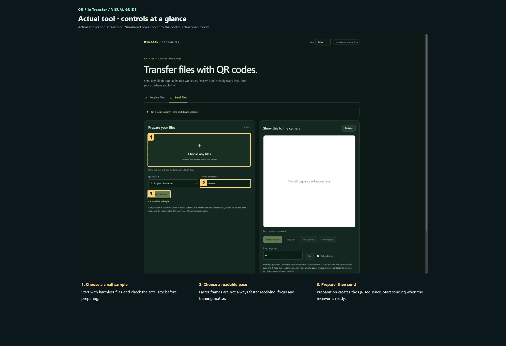
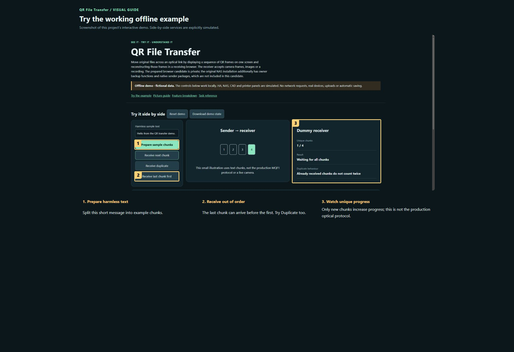

# QR File Transfer — visual user manual

[Project overview](../README.md) · [Offline interactive demo](../demo.html)

Start with the numbered picture guide. Each number identifies the exact highlighted control. Work through one step at a time; the longer reference is below it.

### Actual tool · controls at a glance

Actual application screenshot. Numbered boxes point to the controls described below. 

1. **Choose a small sample.** Start with harmless files and check the total size before preparing.
2. **Choose a readable pace.** Faster frames are not always faster receiving; focus and framing matter.
3. **Prepare, then send.** Preparation creates the QR sequence. Start sending when the receiver is ready.

### Try the working offline example

Screenshot of this project’s interactive demo. Side-by-side services are explicitly simulated.

1. **Prepare harmless text.** Split this short message into example chunks.
2. **Receive out of order.** The last chunk can arrive before the first. Try Duplicate too.
3. **Watch unique progress.** Only new chunks increase progress; this is not the production optical protocol.

## Detailed task reference

### Prepare a small first transfer

1. Open the sender page on the sending computer. Use the included harmless hello.txt example before trying a large archive.
2. Select the intended files and prepare the transfer. Check the filenames and total size; preparation and actual optical transfer are separate stages.
3. Keep the receiver ready before starting the animation. Set a display size and pace that remain sharp and legible on the receiving camera.
4. Start the QR sequence. Avoid window overlap, screen dimming and reflection. Esc stops presentation; restarting the display is not the same as changing the file set.

### Receive and verify

1. Open receiver.html through an HTTPS origin when using a phone camera. Grant camera access deliberately and point it squarely at the sender display.
2. Keep the full QR inside the camera frame. Watch progress rather than expecting each visible frame to decode. Missed or duplicate frames are normal.
3. When reconstruction finishes, save the verified originals. Open a small received file to confirm the expected result before committing to a longer transfer.
4. For image or recording input, choose the appropriate receiver input instead of live camera capture. The same reconstruction and completion checks still apply.

### Resume an interrupted transfer

1. Return using the same browser and origin that holds the saved progress. Do not clear site storage or use a private browsing session expecting persistence.
2. Resume the original transfer rather than preparing a different file selection under a similar filename. Stable identity matters.
3. Check free storage before continuing. Partially received data and reconstructed output can require additional space.
4. If progress stalls, improve focus, lighting and framing or reduce presentation speed. Do not assume a faster animation increases useful throughput.

### Choose whether optical transfer suits the job

1. Try representative small files and measure actual receive progress on your devices.
2. Use that measured rate to judge a large job. Multi-gigabyte optical transfers can take days, and mobile browsers may suspend background tabs.
3. Keep both pages visible and powered during a long transfer. Use the original hosted NAS-backup workflow only when you specifically intend an upload to that NAS.

## Keep your work

The browser candidate stores progress locally; it does not silently send files to a cloud service. A camera recording or someone else’s view of the sender screen can expose the transmitted content: encoding and recovery are not encryption. Keep source files until the received copies are verified and saved.

## If something looks wrong

- Camera unavailable: use HTTPS, check browser permission and ensure another application is not holding the camera.
- No progress: improve framing/focus and reduce frame speed.
- Resume missing: check the exact browser/origin and whether site data was cleared.
- Storage warning: free space or use a smaller transfer; do not repeatedly reload and discard recoverable progress.

## What this manual does not promise

Protocol tests reconstructed 2,337,225 bytes across three files with dropped, reversed and duplicate frames. Build and timing tests passed. Physical camera throughput, cross-phone compatibility and a 4 GB transfer have not been validated. This project must remain private until separately authorised.

Screenshots show the actual application where captured. The offline demo is a deliberately smaller simulation and identifies its dummy services. It never controls devices, sends notifications, uploads files or launches printing.
